# RHI / D3D12RHI 完整成员类图

更新：2026-10-30。范围为当前阶段 A/B 的 RHI、D3D12RHI 公共头中的全部已定义 class/struct（含嵌套类型）；不把 Core、原生 COM 接口内部实现或独立 DirectX12 教程纳入范围。

每张图包含当前类**直接声明**的成员变量、函数、构造/析构、访问器；继承成员通过父类图查阅，不重复展开。省略函数体及部分初始化表达式。枚举作为成员类型引用，嵌套枚举显示其取值。

`+` public，`-` private，`#` protected。`*--` 拥有，`o--` 共享引用，`-->` 借用；静态/虚函数/const/override/default/delete 保留在声明文字中。friend 声明单独列出，不当作成员函数。模板尖括号在 Mermaid 中改写为波浪线，逗号与类型仍保留。

[可搜索的完整 SVG 类图查看器](D3D12RHI_UML_Full.html) · [原架构与帧流程图](D3D12RHI_UML.md)

覆盖 **93 个类/结构体**，共 **577 条直接声明**。

## 继承和主要所有权总览

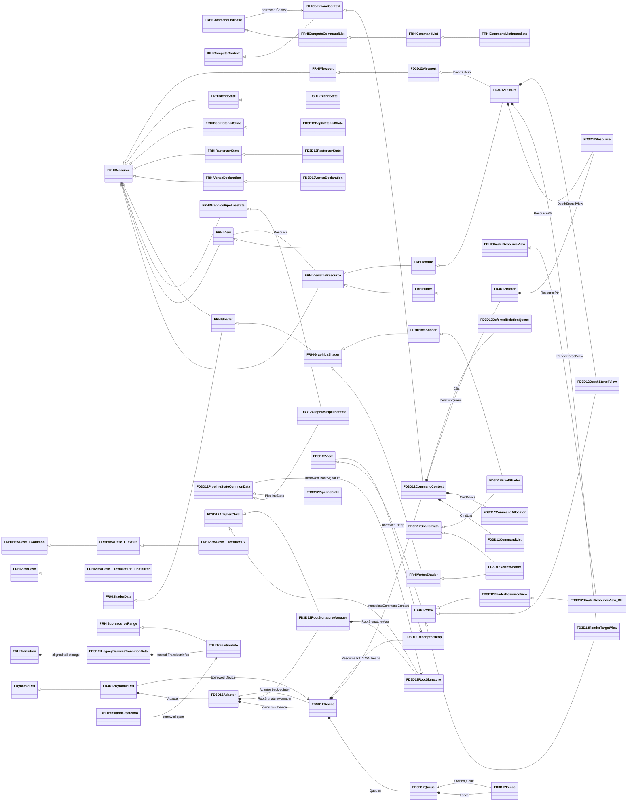

`GDynamicRHI` 是 FDynamicRHI* 全局借用指针，实际指向 FD3D12DynamicRHI；RHI.cpp 内 BackendOwner 拥有对象，ImmediateCommandList 拥有即时命令列表。这些是文件级变量，不是虚构的 RHIStorage 类。

## Source/RHI/Public/DynamicRHI.h

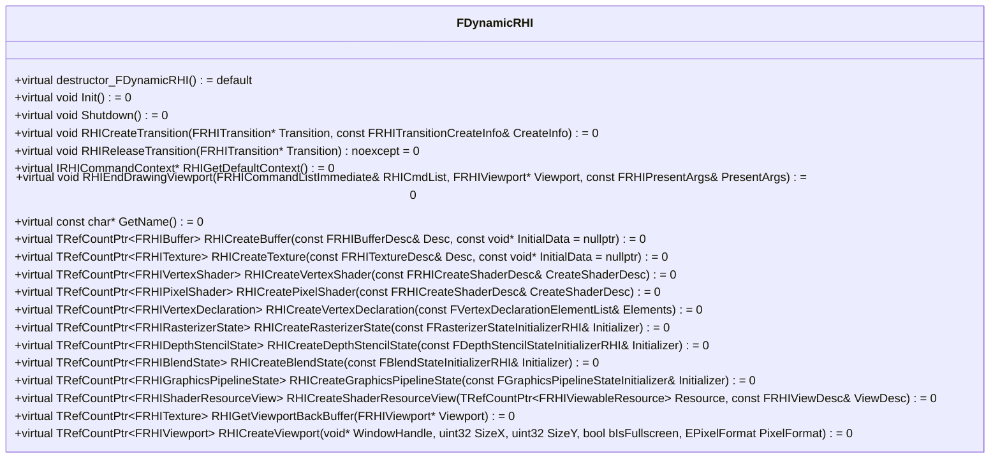

源码：[FDynamicRHI](/F:/workspace/BaseTestEngine/Source/RHI/Public/DynamicRHI.h:12)。

## Source/RHI/Public/RHI.h

```mermaid
classDiagram
class FVertexElement {
    +uint8 StreamIndex = 0
    +uint8 Offset = 0
    +EVertexElementType Type = VET_None
    +uint8 AttributeIndex = 0
    +uint16 Stride = 0
    +uint16 bUseInstanceIndex = 0
    +FVertexElement() = default
    +FVertexElement( uint8 InStreamIndex, uint8 InOffset, EVertexElementType InType, uint8 InAttributeIndex, uint16 InStride, bool bInUseInstanceIndex = false)
}
class FRasterizerStateInitializerRHI {
    +ERasterizerFillMode FillMode = FM_Solid
    +ERasterizerCullMode CullMode = CM_None
    +float DepthBias = 0.0f
    +float SlopeScaleDepthBias = 0.0f
    +ERasterizerDepthClipMode DepthClipMode = ERasterizerDepthClipMode::DepthClip
    +bool bAllowMSAA = false
    +FRasterizerStateInitializerRHI() = default
    +FRasterizerStateInitializerRHI( ERasterizerFillMode InFillMode, ERasterizerCullMode InCullMode, bool bInAllowMSAA )
}
class FDepthStencilStateInitializerRHI {
    +bool bEnableDepthWrite
    +ECompareFunction DepthTest
    +FDepthStencilStateInitializerRHI(bool bInEnableDepthWrite = true, ECompareFunction InDepthTest = CF_LessEqual)
}
class FBlendStateInitializerRHI_FRenderTarget {
    +EBlendOperation ColorBlendOp
    +EBlendFactor ColorSrcBlend
    +EBlendFactor ColorDestBlend
    +EBlendOperation AlphaBlendOp
    +EBlendFactor AlphaSrcBlend
    +EBlendFactor AlphaDestBlend
    +EColorWriteMask ColorWriteMask
    +FRenderTarget( EBlendOperation InColorBlendOp = BO_Add, EBlendFactor InColorSrcBlend = BF_One, EBlendFactor InColorDestBlend = BF_Zero, EBlendOperation InAlphaBlendOp = BO_Add, EBlendFactor InAlphaSrcBlend = BF_One, EBlendFactor InAlphaDestBlend = BF_Zero, EColorWriteMask InColorWriteMask = CW_RGBA)
}
class FBlendStateInitializerRHI {
    +struct FRenderTarget [nested type]
    +std::array~FRenderTarget, MaxSimultaneousRenderTargets~ RenderTargets
    +bool bUseIndependentRenderTargetBlendStates = false
    +bool bUseAlphaToCoverage = false
    +FBlendStateInitializerRHI() = default
    +FBlendStateInitializerRHI(const FRenderTarget& InRenderTargetBlendState, bool bInUseAlphaCoverage = false)
}
```

源码：[FVertexElement](/F:/workspace/BaseTestEngine/Source/RHI/Public/RHI.h:23)。
源码：[FRasterizerStateInitializerRHI](/F:/workspace/BaseTestEngine/Source/RHI/Public/RHI.h:55)。
源码：[FDepthStencilStateInitializerRHI](/F:/workspace/BaseTestEngine/Source/RHI/Public/RHI.h:80)。
源码：[FBlendStateInitializerRHI::FRenderTarget](/F:/workspace/BaseTestEngine/Source/RHI/Public/RHI.h:120)。
源码：[FBlendStateInitializerRHI](/F:/workspace/BaseTestEngine/Source/RHI/Public/RHI.h:116)。

## Source/RHI/Public/RHICommandList.h

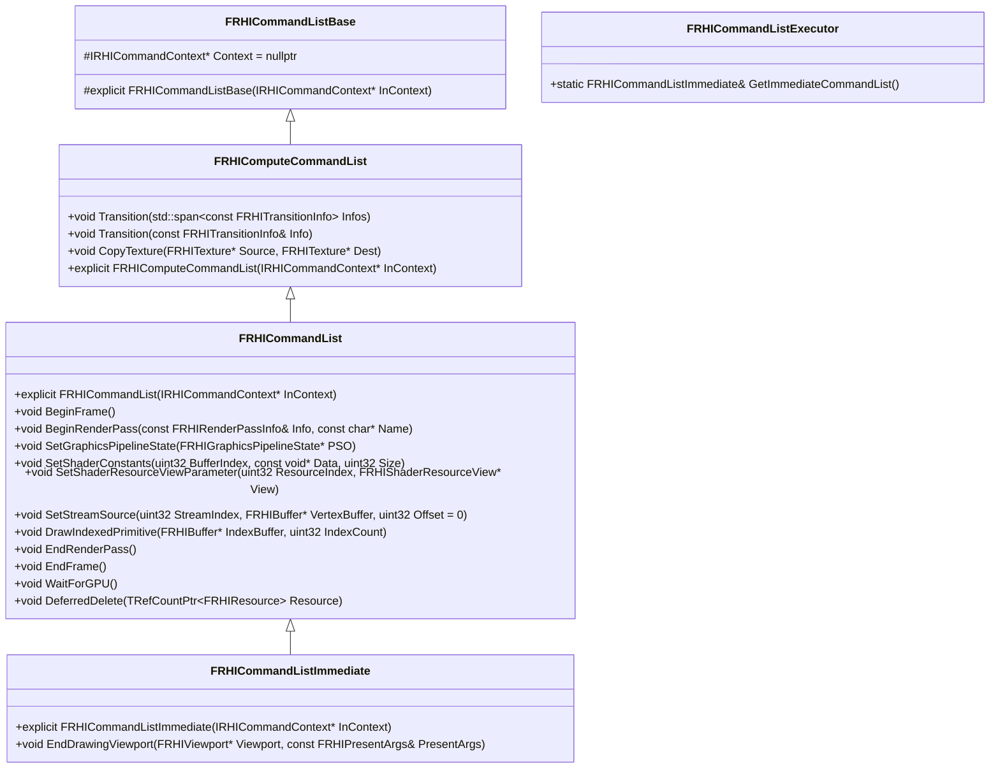

源码：[FRHICommandListBase](/F:/workspace/BaseTestEngine/Source/RHI/Public/RHICommandList.h:9)。
源码：[FRHIComputeCommandList](/F:/workspace/BaseTestEngine/Source/RHI/Public/RHICommandList.h:23)。
源码：[FRHICommandList](/F:/workspace/BaseTestEngine/Source/RHI/Public/RHICommandList.h:45)。
源码：[FRHICommandListImmediate](/F:/workspace/BaseTestEngine/Source/RHI/Public/RHICommandList.h:106)。
源码：[FRHICommandListExecutor](/F:/workspace/BaseTestEngine/Source/RHI/Public/RHICommandList.h:114)。

## Source/RHI/Public/RHIContext.h

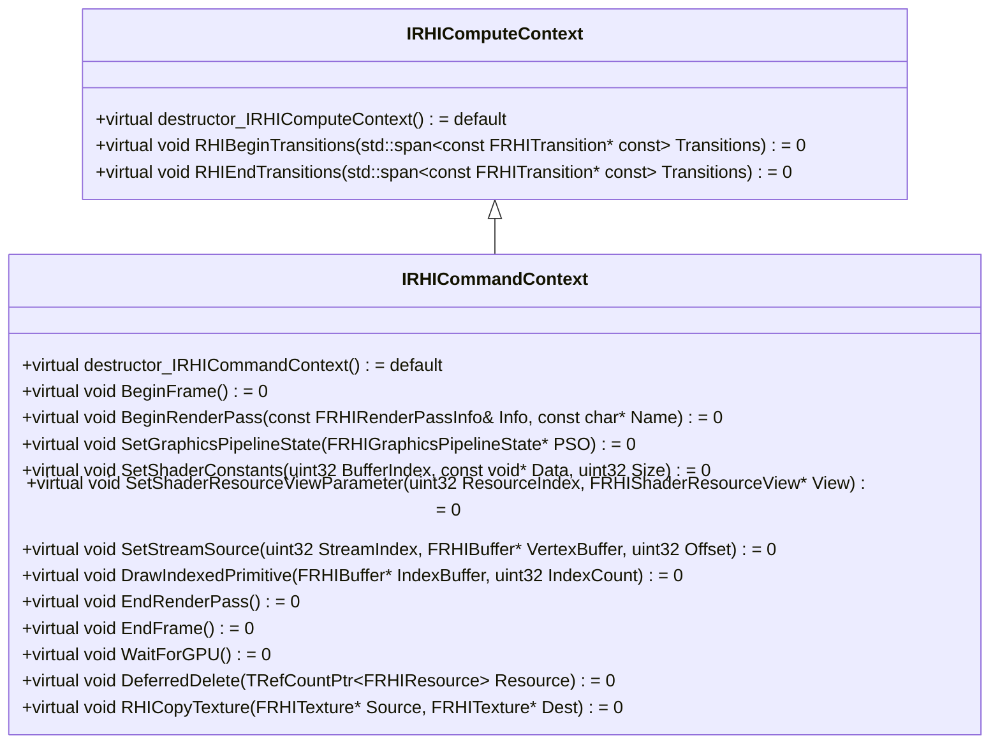

源码：[IRHIComputeContext](/F:/workspace/BaseTestEngine/Source/RHI/Public/RHIContext.h:8)。
源码：[IRHICommandContext](/F:/workspace/BaseTestEngine/Source/RHI/Public/RHIContext.h:18)。

## Source/RHI/Public/RHIResources.h

```mermaid
classDiagram
class FRHIResource {
    +explicit FRHIResource(ERHIResourceType InResourceType)
    +virtual destructor_FRHIResource()
    +ERHIResourceType GetType() const
    -ERHIResourceType ResourceType
}
class FRHIBufferDesc {
    +uint32 Size = 0
    +uint32 Stride = 0
    +EBufferUsageFlags Usage = EBufferUsageFlags::None
    +FRHIBufferDesc() = default
    +FRHIBufferDesc(uint32 InSize, uint32 InStride, EBufferUsageFlags InUsage)
}
class FRHIViewableResource {
    #explicit FRHIViewableResource(ERHIResourceType InResourceType)
}
class FRHIBuffer {
    +explicit FRHIBuffer(const FRHIBufferDesc& InDesc)
    +const FRHIBufferDesc& GetDesc() const
    +uint32 GetSize() const
    +uint32 GetStride()const
    +EBufferUsageFlags GetUsage() const
    -FRHIBufferDesc Desc
}
class FClearValueBinding {
    +FClearValueBinding() = default
    +explicit FClearValueBinding(EClearBinding InBinding)
    +explicit FClearValueBinding( const std::array~float, 4~& InClearColor)
    +explicit FClearValueBinding( float DepthClearValue, uint32 StencilClearValue = 0)
    +std::array~float, 4~ GetClearColor() const
    +void GetDepthStencil( float& OutDepth, uint32& OutStencil) const
    -EClearBinding ColorBinding = EClearBinding::EColorBound
    -std::array~float, 4~ Color
    -float Depth = 0.0f
    -uint32 Stencil = 0
}
class FRHITextureDesc {
    +uint32 Width = 1
    +uint32 Height = 1
    +EPixelFormat Format = PF_Unknown
    +FRHITextureDesc() = default
    +FRHITextureDesc(uint32 InW, uint32 InH, EPixelFormat InFmt)
    +FClearValueBinding ClearValue
    +ETextureCreateFlags Flags = ETextureCreateFlags::None
}
class FRHITexture {
    +explicit FRHITexture(const FRHITextureDesc& InDesc)
    +const FRHITextureDesc& GetDesc() const
    -FRHITextureDesc Desc
}
class FRHIViewDesc_FCommon {
    +EViewType ViewType = EViewType::TextureSRV
    +EPixelFormat Format = PF_Unknown
}
class FRHIViewDesc_FTexture_FMipRange {
    +uint8 First = 0
    +uint8 Num = 1
}
class FRHIViewDesc_FTexture {
    +EDimension Dimension = EDimension::Texture2D
    +struct FMipRange [nested type]
    +FMipRange MipRange
}
class FRHIViewDesc_FTextureSRV {
    +struct FInitializer
}
class FRHIViewDesc_FTextureViews {
    +FTextureSRV SRV
}
class FRHIViewDesc {
    +enum class EViewType :uint8 ( TextureSRV, )
    +enum class EDimension :uint8 ( Texture2D, )
    +struct FCommon [nested type]
    +struct FTexture :public FCommon [nested type]
    +struct FTextureSRV :public FTexture [nested type]
    +struct FTextureViews [nested type]
    +FTextureViews Texture
    +static FTextureSRV::FInitializer CreateTextureSRV()
    +bool IsSRV() const
    +bool IsTexture() const
}
class FRHIViewDesc_FTextureSRV_FInitializer {
    -FInitializer() = default
    +FInitializer& SetFormat(EPixelFormat InFormat)
    +FInitializer& SetMipRange(uint8 InFirstMip, uint8 InNumMips)
    +FRHIViewDesc Build() const
}
class FRHIView {
    +FRHIViewableResource* GetResource() const
    +const FRHIViewDesc& GetDesc() const
    +bool IsTexture() const
    +FRHITexture* GetTexture() const
    #FRHIView(ERHIResourceType InResourceType, TRefCountPtr~FRHIViewableResource~ InResource, const FRHIViewDesc& InViewDesc)
    -TRefCountPtr~FRHIViewableResource~ Resource
    #const FRHIViewDesc ViewDesc
}
class FRHIShaderResourceView {
    +FRHIShaderResourceView(TRefCountPtr~FRHIViewableResource~ InResource, const FRHIViewDesc& InViewDesc)
}
class FRHIGraphicsPipelineState {
    +FRHIGraphicsPipelineState()
}
class FRHIShaderData {
}
class FRHIShader {
    +FRHIShader(ERHIResourceType InResourceType, EShaderFrequency InFrequency)
    +EShaderFrequency GetFrequency() const
    -EShaderFrequency Frequency
}
class FRHIGraphicsShader {
    +FRHIGraphicsShader(ERHIResourceType InResourceType, EShaderFrequency InFrequency)
}
class FRHIVertexShader {
    +FRHIVertexShader()
}
class FRHIPixelShader {
    +FRHIPixelShader()
}
class FShaderCodePackedResourceCounts {
    +uint8 NumSamplers = 0
    +uint8 NumSRVs = 0
    +uint8 NumCBs = 0
    +uint8 NumUAVs = 0
}
class FRHICreateShaderDesc {
    +std::span~const uint8~ Code
    +FShaderCodePackedResourceCounts ResourceCounts
    +explicit FRHICreateShaderDesc(std::span~const uint8~ InCode)
}
class FRHIVertexDeclaration {
    +FRHIVertexDeclaration()
    +virtual bool GetInitializer(FVertexDeclarationElementList& Init)
}
class FBoundShaderStateInput {
    +TRefCountPtr~FRHIVertexDeclaration~ VertexDeclarationRHI
    +TRefCountPtr~FRHIVertexShader~ VertexShaderRHI
    +TRefCountPtr~FRHIPixelShader~ PixelShaderRHI
    +FBoundShaderStateInput() = default
    +FBoundShaderStateInput( const TRefCountPtr~FRHIVertexDeclaration~& InVertexDeclarationRHI, const TRefCountPtr~FRHIVertexShader~& InVertexShaderRHI, const TRefCountPtr~FRHIPixelShader~& InPixelShaderRHI )
    +FRHIVertexShader* GetVertexShader() const
    +FRHIPixelShader* GetPixelShader() const
}
class FRHIRasterizerState {
    +FRHIRasterizerState()
    +virtual bool GetInitializer(FRasterizerStateInitializerRHI& Init)
}
class FRHIDepthStencilState {
    +FRHIDepthStencilState()
    +virtual bool GetInitializer(FDepthStencilStateInitializerRHI& Init)
}
class FRHIBlendState {
    +FRHIBlendState()
    +virtual bool GetInitializer(FBlendStateInitializerRHI& Init)
}
class FGraphicsPipelineStateInitializer {
    +using TRenderTargetFormats = std::array~EPixelFormat, MaxSimultaneousRenderTargets~
    +FBoundShaderStateInput BoundShaderState
    +TRefCountPtr~FRHIRasterizerState~ RasterizerState
    +TRefCountPtr~FRHIDepthStencilState~ DepthStencilState
    +TRefCountPtr~FRHIBlendState~ BlendState
    +EPrimitiveType PrimitiveType = PT_TriangleList
    +uint32 RenderTargetsEnabled = 0
    +TRenderTargetFormats RenderTargetFormats
    +EPixelFormat DepthStencilTargetFormat = PF_Unknown
    +uint16 NumSamples = 1
}
class FRHIRenderPassInfo_FColorEntry {
    +FRHITexture* RenderTarget = nullptr
    +FRHITexture* ResolveTarget = nullptr
    +int32 ArraySlice = -1
    +uint8 MipIndex = 0
    +ERenderTargetActions Action = ERenderTargetActions::DontLoad_DontStore
}
class FRHIRenderPassInfo_FDepthStencilEntry {
    +FRHITexture* DepthStencilTarget = nullptr
    +FRHITexture* ResolveTarget = nullptr
    +EDepthStencilTargetActions Action = EDepthStencilTargetActions::DontLoad_DontStore
}
class FRHIRenderPassInfo {
    +struct FColorEntry [nested type]
    +std::array~FColorEntry, MaxSimultaneousRenderTargets~ ColorRenderTargets
    +struct FDepthStencilEntry [nested type]
    +FDepthStencilEntry DepthStencilRenderTarget
    +FRHIRenderPassInfo() = default
}
class FRHIViewport {
    +FRHIViewport()
}
class FRHIPresentArgs {
    +FRHIPresentArgs(uint64 InFrameCounter, bool bInPresent, bool bInLockToVsync)
    +uint64 FrameCounter
    +bool bPresent
    +bool bLockToVsync
}
FRHIResource <|-- FRHIViewableResource
FRHIViewableResource <|-- FRHIBuffer
FRHIViewableResource <|-- FRHITexture
FRHIViewDesc_FCommon <|-- FRHIViewDesc_FTexture
FRHIViewDesc_FTexture <|-- FRHIViewDesc_FTextureSRV
FRHIViewDesc <|-- FRHIViewDesc_FTextureSRV_FInitializer
FRHIResource <|-- FRHIView
FRHIView <|-- FRHIShaderResourceView
FRHIResource <|-- FRHIGraphicsPipelineState
FRHIResource <|-- FRHIShader
FRHIShaderData <|-- FRHIShader
FRHIShader <|-- FRHIGraphicsShader
FRHIGraphicsShader <|-- FRHIVertexShader
FRHIGraphicsShader <|-- FRHIPixelShader
FRHIResource <|-- FRHIVertexDeclaration
FRHIResource <|-- FRHIRasterizerState
FRHIResource <|-- FRHIDepthStencilState
FRHIResource <|-- FRHIBlendState
FRHIResource <|-- FRHIViewport
```

源码：[FRHIResource](/F:/workspace/BaseTestEngine/Source/RHI/Public/RHIResources.h:24)。
源码：[FRHIBufferDesc](/F:/workspace/BaseTestEngine/Source/RHI/Public/RHIResources.h:36)。
源码：[FRHIViewableResource](/F:/workspace/BaseTestEngine/Source/RHI/Public/RHIResources.h:48)。
源码：[FRHIBuffer](/F:/workspace/BaseTestEngine/Source/RHI/Public/RHIResources.h:61)。
源码：[FClearValueBinding](/F:/workspace/BaseTestEngine/Source/RHI/Public/RHIResources.h:86)。
源码：[FRHITextureDesc](/F:/workspace/BaseTestEngine/Source/RHI/Public/RHIResources.h:158)。
源码：[FRHITexture](/F:/workspace/BaseTestEngine/Source/RHI/Public/RHIResources.h:172)。
源码：[FRHIViewDesc::FCommon](/F:/workspace/BaseTestEngine/Source/RHI/Public/RHIResources.h:203)。
源码：[FRHIViewDesc::FTexture::FMipRange](/F:/workspace/BaseTestEngine/Source/RHI/Public/RHIResources.h:212)。
源码：[FRHIViewDesc::FTexture](/F:/workspace/BaseTestEngine/Source/RHI/Public/RHIResources.h:209)。
源码：[FRHIViewDesc::FTextureSRV](/F:/workspace/BaseTestEngine/Source/RHI/Public/RHIResources.h:221)。
源码：[FRHIViewDesc::FTextureViews](/F:/workspace/BaseTestEngine/Source/RHI/Public/RHIResources.h:227)。
源码：[FRHIViewDesc](/F:/workspace/BaseTestEngine/Source/RHI/Public/RHIResources.h:189)。
源码：[FRHIViewDesc::FTextureSRV::FInitializer](/F:/workspace/BaseTestEngine/Source/RHI/Public/RHIResources.h:247)。
友元：`friend struct FRHIViewDesc`
源码：[FRHIView](/F:/workspace/BaseTestEngine/Source/RHI/Public/RHIResources.h:290)。
源码：[FRHIShaderResourceView](/F:/workspace/BaseTestEngine/Source/RHI/Public/RHIResources.h:337)。
源码：[FRHIGraphicsPipelineState](/F:/workspace/BaseTestEngine/Source/RHI/Public/RHIResources.h:374)。
源码：[FRHIShaderData](/F:/workspace/BaseTestEngine/Source/RHI/Public/RHIResources.h:400)。
源码：[FRHIShader](/F:/workspace/BaseTestEngine/Source/RHI/Public/RHIResources.h:405)。
源码：[FRHIGraphicsShader](/F:/workspace/BaseTestEngine/Source/RHI/Public/RHIResources.h:421)。
源码：[FRHIVertexShader](/F:/workspace/BaseTestEngine/Source/RHI/Public/RHIResources.h:429)。
源码：[FRHIPixelShader](/F:/workspace/BaseTestEngine/Source/RHI/Public/RHIResources.h:437)。
源码：[FShaderCodePackedResourceCounts](/F:/workspace/BaseTestEngine/Source/RHI/Public/RHIResources.h:453)。
源码：[FRHICreateShaderDesc](/F:/workspace/BaseTestEngine/Source/RHI/Public/RHIResources.h:463)。
源码：[FRHIVertexDeclaration](/F:/workspace/BaseTestEngine/Source/RHI/Public/RHIResources.h:477)。
源码：[FBoundShaderStateInput](/F:/workspace/BaseTestEngine/Source/RHI/Public/RHIResources.h:498)。
源码：[FRHIRasterizerState](/F:/workspace/BaseTestEngine/Source/RHI/Public/RHIResources.h:525)。
源码：[FRHIDepthStencilState](/F:/workspace/BaseTestEngine/Source/RHI/Public/RHIResources.h:539)。
源码：[FRHIBlendState](/F:/workspace/BaseTestEngine/Source/RHI/Public/RHIResources.h:552)。
源码：[FGraphicsPipelineStateInitializer](/F:/workspace/BaseTestEngine/Source/RHI/Public/RHIResources.h:567)。
源码：[FRHIRenderPassInfo::FColorEntry](/F:/workspace/BaseTestEngine/Source/RHI/Public/RHIResources.h:731)。
源码：[FRHIRenderPassInfo::FDepthStencilEntry](/F:/workspace/BaseTestEngine/Source/RHI/Public/RHIResources.h:744)。
源码：[FRHIRenderPassInfo](/F:/workspace/BaseTestEngine/Source/RHI/Public/RHIResources.h:728)。
源码：[FRHIViewport](/F:/workspace/BaseTestEngine/Source/RHI/Public/RHIResources.h:760)。
源码：[FRHIPresentArgs](/F:/workspace/BaseTestEngine/Source/RHI/Public/RHIResources.h:769)。

## Source/RHI/Public/RHITransition.h

```mermaid
classDiagram
class FRHISubresourceRange {
    +static constexpr uint16 kDepthPlaneSlice = 0
    +static constexpr uint16 kStencilPlaneSlice = 1
    +static constexpr uint16 kAllSubresources = (std::numeric_limits~uint16~::max)()
    +uint16 MipIndex = kAllSubresources
    +uint16 ArraySlice = kAllSubresources
    +uint16 PlaneSlice = kAllSubresources
    +FRHISubresourceRange() = default
    +FRHISubresourceRange(uint32 InMipIndex, uint32 InArraySlice, uint32 InPlaneSlice)
    +bool IsAllMips() const
    +bool IsAllArraySlices() const
    +bool IsAllPlaneSlices() const
    +bool IsWholeResource() const
}
class FRHITransitionInfo {
    +FRHITexture* Texture = nullptr [union]
    +FRHIBuffer* Buffer [union]
    +enum class EType : uint8 ( Unknown, Texture, Buffer, )
    +Type = EType::Unknown
    +ERHIAccess AccessBefore = ERHIAccess::Unknown
    +ERHIAccess AccessAfter = ERHIAccess::Unknown
    +EResourceTransitionFlags Flags = EResourceTransitionFlags::None
    +FRHITransitionInfo() = default
    +FRHITransitionInfo( FRHITexture* InTexture, ERHIAccess InPreviousState, ERHIAccess InNewState, EResourceTransitionFlags InFlags = EResourceTransitionFlags::None, uint32 InMipIndex = kAllSubresources, uint32 InArraySlice = kAllSubresources, uint32 InPlaneSlice = kAllSubresources)
    +FRHITransitionInfo( FRHIBuffer* InRHIBuffer, ERHIAccess InPreviousState, ERHIAccess InNewState, EResourceTransitionFlags InFlags = EResourceTransitionFlags::None)
}
class FRHITransitionCreateInfo {
    +FRHITransitionCreateInfo() = default
    +FRHITransitionCreateInfo( ERHIPipeline InSrcPipelines, ERHIPipeline InDstPipelines, ERHITransitionCreateFlags InFlags = ERHITransitionCreateFlags::None, std::span~const FRHITransitionInfo~ InTransitionInfos =
    +)
    +ERHIPipeline SrcPipelines = ERHIPipeline::None
    +ERHIPipeline DstPipelines = ERHIPipeline::None
    +ERHITransitionCreateFlags Flags = ERHITransitionCreateFlags::None
    +std::span~const FRHITransitionInfo~ TransitionInfos
}
class FRHITransition {
    +FRHITransition(const FRHITransition&) = delete
    +FRHITransition& operator=(const FRHITransition&) = delete
    +FRHITransition(FRHITransition&&) = delete
    +FRHITransition& operator=(FRHITransition&&) = delete
    +template~typename T~ T* GetPrivateData()
    +template~typename T~ const T* GetPrivateData() const
    -FRHITransition() = default
    -destructor_FRHITransition() = default
    -FDynamicRHI* Owner = nullptr
    -size_t PrivateOffset = 0
    -size_t PrivateSize = 0
    -size_t PrivateAlignment = 0
    -size_t AllocationAlignment = 0
}
FRHISubresourceRange <|-- FRHITransitionInfo
```

源码：[FRHISubresourceRange](/F:/workspace/BaseTestEngine/Source/RHI/Public/RHITransition.h:38)。
源码：[FRHITransitionInfo](/F:/workspace/BaseTestEngine/Source/RHI/Public/RHITransition.h:91)。
源码：[FRHITransitionCreateInfo](/F:/workspace/BaseTestEngine/Source/RHI/Public/RHITransition.h:158)。
源码：[FRHITransition](/F:/workspace/BaseTestEngine/Source/RHI/Public/RHITransition.h:202)。
友元：`friend RHIMODULE FRHITransition* RHICreateTransition(const FRHITransitionCreateInfo&)`；`friend RHIMODULE void RHIReleaseTransition(FRHITransition*) noexcept`

## Source/D3D12RHI/Public/D3D12Adapter.h

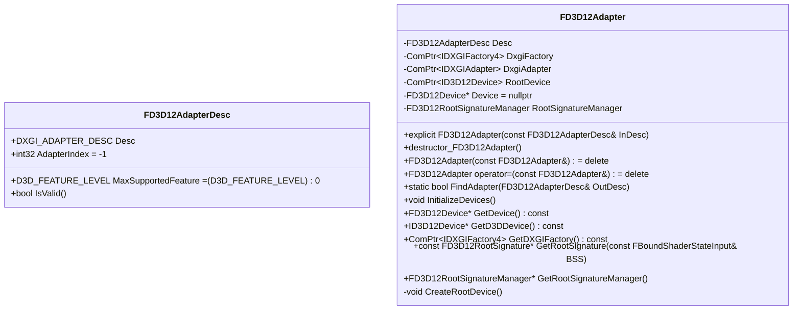

源码：[FD3D12AdapterDesc](/F:/workspace/BaseTestEngine/Source/D3D12RHI/Public/D3D12Adapter.h:19)。
源码：[FD3D12Adapter](/F:/workspace/BaseTestEngine/Source/D3D12RHI/Public/D3D12Adapter.h:30)。

## Source/D3D12RHI/Public/D3D12CommandContext.h

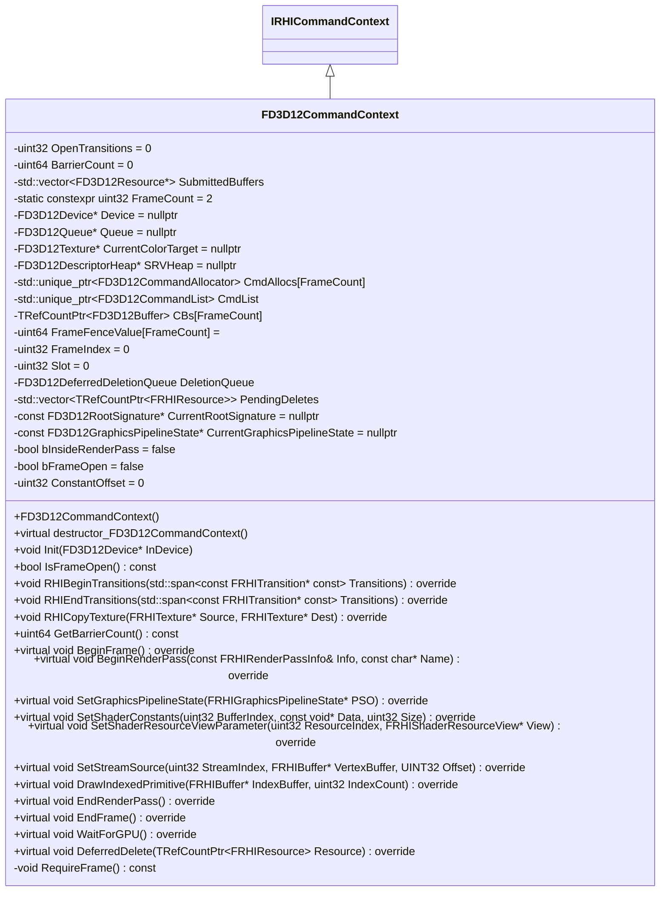

源码：[FD3D12CommandContext](/F:/workspace/BaseTestEngine/Source/D3D12RHI/Public/D3D12CommandContext.h:22)。

## Source/D3D12RHI/Public/D3D12CommandList.h

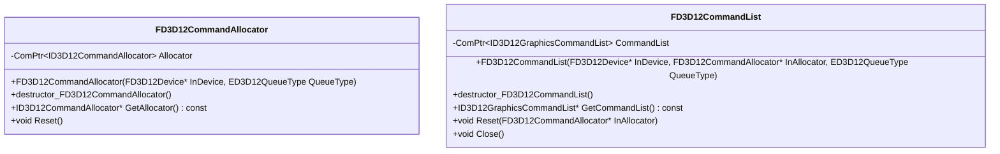

源码：[FD3D12CommandAllocator](/F:/workspace/BaseTestEngine/Source/D3D12RHI/Public/D3D12CommandList.h:11)。
源码：[FD3D12CommandList](/F:/workspace/BaseTestEngine/Source/D3D12RHI/Public/D3D12CommandList.h:24)。

## Source/D3D12RHI/Public/D3D12DeferredDeletionQueue.h

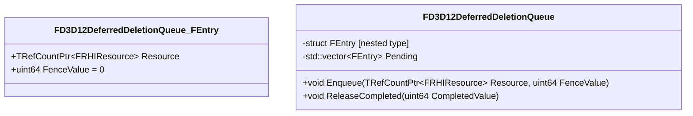

源码：[FD3D12DeferredDeletionQueue::FEntry](/F:/workspace/BaseTestEngine/Source/D3D12RHI/Public/D3D12DeferredDeletionQueue.h:18)。
源码：[FD3D12DeferredDeletionQueue](/F:/workspace/BaseTestEngine/Source/D3D12RHI/Public/D3D12DeferredDeletionQueue.h:8)。

## Source/D3D12RHI/Public/D3D12Descriptors.h

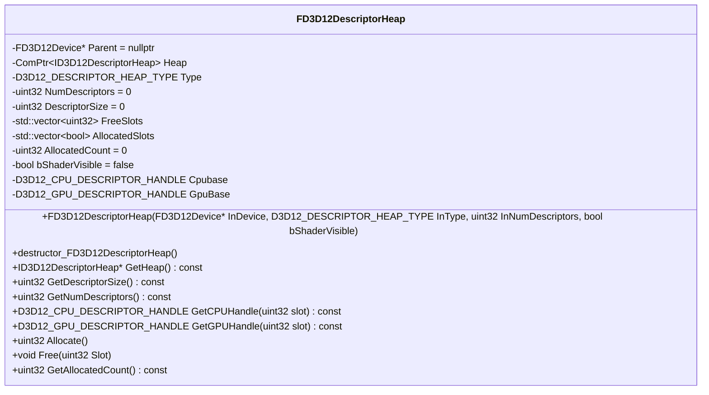

源码：[FD3D12DescriptorHeap](/F:/workspace/BaseTestEngine/Source/D3D12RHI/Public/D3D12Descriptors.h:39)。

## Source/D3D12RHI/Public/D3D12Device.h

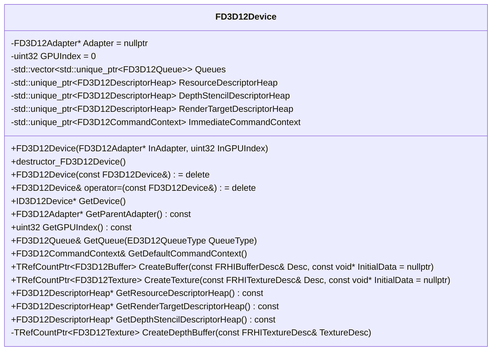

源码：[FD3D12Device](/F:/workspace/BaseTestEngine/Source/D3D12RHI/Public/D3D12Device.h:27)。

## Source/D3D12RHI/Public/D3D12DynamicRHI.h

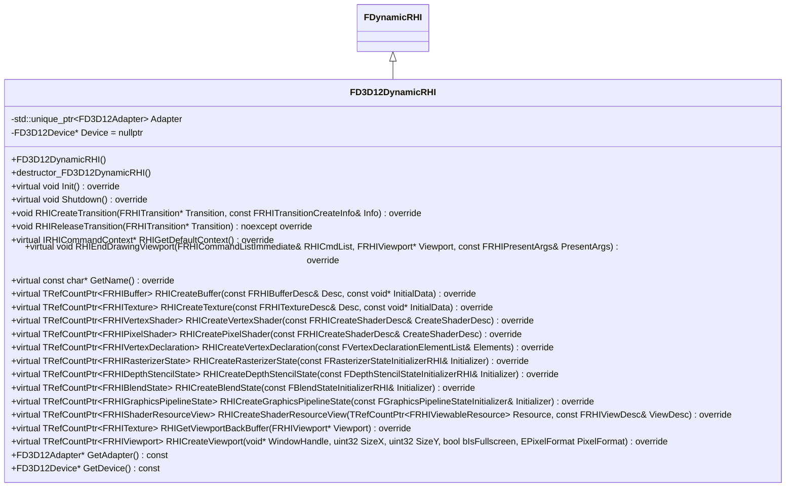

源码：[FD3D12DynamicRHI](/F:/workspace/BaseTestEngine/Source/D3D12RHI/Public/D3D12DynamicRHI.h:14)。

## Source/D3D12RHI/Public/D3D12LegacyBarriers.h

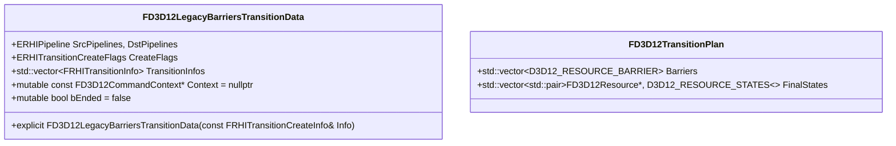

源码：[FD3D12LegacyBarriersTransitionData](/F:/workspace/BaseTestEngine/Source/D3D12RHI/Public/D3D12LegacyBarriers.h:13)。
源码：[FD3D12TransitionPlan](/F:/workspace/BaseTestEngine/Source/D3D12RHI/Public/D3D12LegacyBarriers.h:25)。

## Source/D3D12RHI/Public/D3D12PipelineState.h

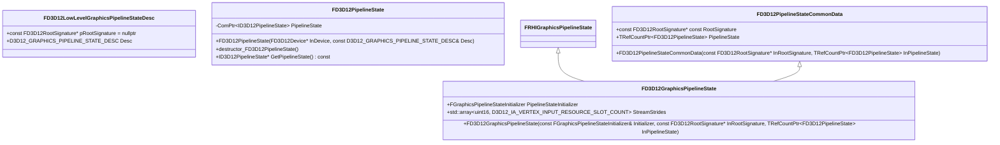

源码：[FD3D12LowLevelGraphicsPipelineStateDesc](/F:/workspace/BaseTestEngine/Source/D3D12RHI/Public/D3D12PipelineState.h:12)。
源码：[FD3D12PipelineState](/F:/workspace/BaseTestEngine/Source/D3D12RHI/Public/D3D12PipelineState.h:22)。
源码：[FD3D12PipelineStateCommonData](/F:/workspace/BaseTestEngine/Source/D3D12RHI/Public/D3D12PipelineState.h:36)。
源码：[FD3D12GraphicsPipelineState](/F:/workspace/BaseTestEngine/Source/D3D12RHI/Public/D3D12PipelineState.h:49)。

## Source/D3D12RHI/Public/D3D12Queue.h

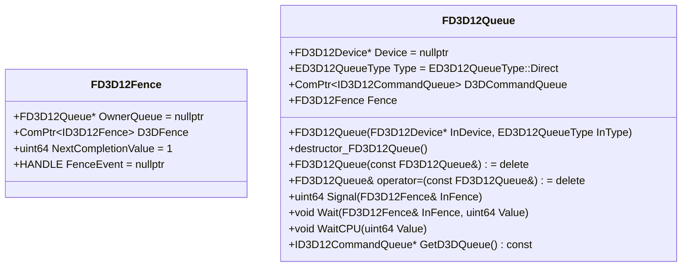

源码：[FD3D12Fence](/F:/workspace/BaseTestEngine/Source/D3D12RHI/Public/D3D12Queue.h:40)。
源码：[FD3D12Queue](/F:/workspace/BaseTestEngine/Source/D3D12RHI/Public/D3D12Queue.h:49)。

## Source/D3D12RHI/Public/D3D12Resources.h

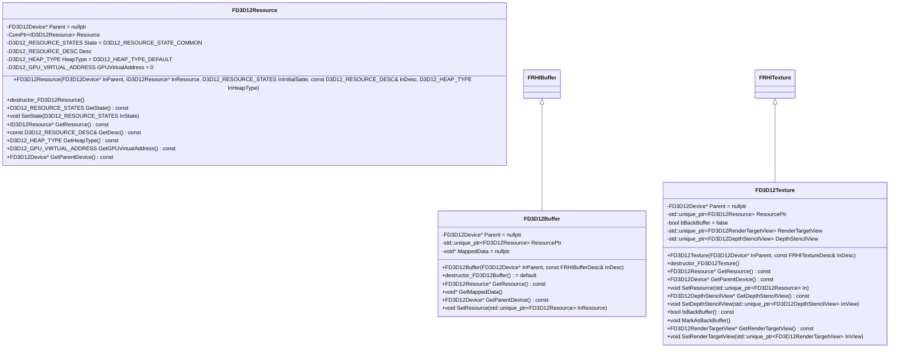

源码：[FD3D12Resource](/F:/workspace/BaseTestEngine/Source/D3D12RHI/Public/D3D12Resources.h:16)。
源码：[FD3D12Buffer](/F:/workspace/BaseTestEngine/Source/D3D12RHI/Public/D3D12Resources.h:52)。
源码：[FD3D12Texture](/F:/workspace/BaseTestEngine/Source/D3D12RHI/Public/D3D12Resources.h:76)。

## Source/D3D12RHI/Public/D3D12RootSignature.h

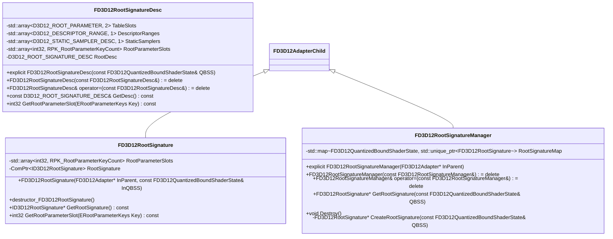

源码：[FD3D12RootSignatureDesc](/F:/workspace/BaseTestEngine/Source/D3D12RHI/Public/D3D12RootSignature.h:24)。
源码：[FD3D12RootSignature](/F:/workspace/BaseTestEngine/Source/D3D12RHI/Public/D3D12RootSignature.h:55)。
源码：[FD3D12RootSignatureManager](/F:/workspace/BaseTestEngine/Source/D3D12RHI/Public/D3D12RootSignature.h:71)。

## Source/D3D12RHI/Public/D3D12Shader.h

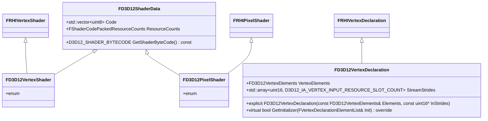

源码：[FD3D12ShaderData](/F:/workspace/BaseTestEngine/Source/D3D12RHI/Public/D3D12Shader.h:18)。
源码：[FD3D12VertexShader](/F:/workspace/BaseTestEngine/Source/D3D12RHI/Public/D3D12Shader.h:31)。
源码：[FD3D12PixelShader](/F:/workspace/BaseTestEngine/Source/D3D12RHI/Public/D3D12Shader.h:38)。
源码：[FD3D12VertexDeclaration](/F:/workspace/BaseTestEngine/Source/D3D12RHI/Public/D3D12Shader.h:46)。

## Source/D3D12RHI/Public/D3D12State.h

```mermaid
classDiagram
class FD3D12RasterizerState {
    +D3D12_RASTERIZER_DESC Desc
    +virtual bool GetInitializer(FRasterizerStateInitializerRHI& Init) override
}
class FD3D12DepthStencilState {
    +D3D12_DEPTH_STENCIL_DESC Desc
    +virtual bool GetInitializer(FDepthStencilStateInitializerRHI& Init) override
}
class FD3D12BlendState {
    +D3D12_BLEND_DESC Desc
    +virtual bool GetInitializer(FBlendStateInitializerRHI& Init) override
}
FRHIRasterizerState <|-- FD3D12RasterizerState
FRHIDepthStencilState <|-- FD3D12DepthStencilState
FRHIBlendState <|-- FD3D12BlendState
```

源码：[FD3D12RasterizerState](/F:/workspace/BaseTestEngine/Source/D3D12RHI/Public/D3D12State.h:6)。
源码：[FD3D12DepthStencilState](/F:/workspace/BaseTestEngine/Source/D3D12RHI/Public/D3D12State.h:14)。
源码：[FD3D12BlendState](/F:/workspace/BaseTestEngine/Source/D3D12RHI/Public/D3D12State.h:21)。

## Source/D3D12RHI/Public/D3D12Util.h

```mermaid
classDiagram
class FD3D12AdapterChild {
    +explicit FD3D12AdapterChild(FD3D12Adapter* InParent)
    +FD3D12Adapter* GetParentAdapter() const
    -FD3D12Adapter* ParentAdapter = nullptr
}
class FShaderRegisterCounts {
    +uint8 SamplerCount = 0
    +uint8 ConstantBufferCount = 0
    +uint8 ShaderResourceCount = 0
    +uint8 UnorderedAccessCount = 0
    +auto operator~=~(const FShaderRegisterCounts&) const = default
}
class FD3D12QuantizedBoundShaderState {
    +std::array~FShaderRegisterCounts, SV_ShaderVisibilityCount~ RegisterCounts
    +bool bAllowIAInputLayout = false
    +auto operator~=~(const FD3D12QuantizedBoundShaderState&) const = default
}
```

源码：[FD3D12AdapterChild](/F:/workspace/BaseTestEngine/Source/D3D12RHI/Public/D3D12Util.h:11)。
源码：[FShaderRegisterCounts](/F:/workspace/BaseTestEngine/Source/D3D12RHI/Public/D3D12Util.h:34)。
源码：[FD3D12QuantizedBoundShaderState](/F:/workspace/BaseTestEngine/Source/D3D12RHI/Public/D3D12Util.h:44)。

## Source/D3D12RHI/Public/D3D12View.h

```mermaid
classDiagram
class FD3D12View {
    +FD3D12View(const FD3D12View&) = delete
    +FD3D12View& operator=(const FD3D12View&) = delete
    +bool IsInitialized() const
    +D3D12_CPU_DESCRIPTOR_HANDLE GetCPUHandle() const
    +D3D12_GPU_DESCRIPTOR_HANDLE GetGPUHandle() const
    #FD3D12View( FD3D12Device* InDevice, FD3D12DescriptorHeap* InHeap)
    #virtual destructor_FD3D12View()
    #FD3D12Device* ParentDevice = nullptr
    #FD3D12DescriptorHeap* Heap = nullptr
    #D3D12_CPU_DESCRIPTOR_HANDLE CPUHandle
    #D3D12_GPU_DESCRIPTOR_HANDLE GPUHandle
    #uint32 DescriptorSlot = 0
    #bool bInitialized = false
}
class TD3D12View {
    +const ViewDescType& GetDesc() const
    #TD3D12View( FD3D12Device* InDevice, FD3D12DescriptorHeap* InHeap)
    #ViewDescType Desc
}
class FD3D12RenderTargetView {
    +FD3D12RenderTargetView(FD3D12Device* InDevice, FD3D12DescriptorHeap* InHeap)
    +void CreateView(FD3D12Resource* InResource, const D3D12_RENDER_TARGET_VIEW_DESC& InDesc)
}
class FD3D12DepthStencilView {
    +FD3D12DepthStencilView(FD3D12Device* InDevice, FD3D12DescriptorHeap* InHeap)
    +void CreateView(FD3D12Resource* InResource, const D3D12_DEPTH_STENCIL_VIEW_DESC& InDesc)
}
class FD3D12ShaderResourceView {
    +FD3D12ShaderResourceView( FD3D12Device* InDevice, FD3D12DescriptorHeap* InHeap)
    +void CreateView( FD3D12Resource* InResource, const D3D12_SHADER_RESOURCE_VIEW_DESC& InDesc)
}
class FD3D12ShaderResourceView_RHI {
    +FD3D12ShaderResourceView_RHI( FD3D12Device* InDevice, FD3D12DescriptorHeap* InHeap, TRefCountPtr~FRHIViewableResource~ InResource, const FRHIViewDesc& InViewDesc)
    +void CreateView()
}
FD3D12View <|-- TD3D12View
TD3D12View <|-- FD3D12RenderTargetView
TD3D12View <|-- FD3D12DepthStencilView
TD3D12View <|-- FD3D12ShaderResourceView
FRHIShaderResourceView <|-- FD3D12ShaderResourceView_RHI
FD3D12ShaderResourceView <|-- FD3D12ShaderResourceView_RHI
```

源码：[FD3D12View](/F:/workspace/BaseTestEngine/Source/D3D12RHI/Public/D3D12View.h:26)。
源码：[TD3D12View](/F:/workspace/BaseTestEngine/Source/D3D12RHI/Public/D3D12View.h:66)。
源码：[FD3D12RenderTargetView](/F:/workspace/BaseTestEngine/Source/D3D12RHI/Public/D3D12View.h:87)。
源码：[FD3D12DepthStencilView](/F:/workspace/BaseTestEngine/Source/D3D12RHI/Public/D3D12View.h:95)。
源码：[FD3D12ShaderResourceView](/F:/workspace/BaseTestEngine/Source/D3D12RHI/Public/D3D12View.h:102)。
源码：[FD3D12ShaderResourceView_RHI](/F:/workspace/BaseTestEngine/Source/D3D12RHI/Public/D3D12View.h:116)。

## Source/D3D12RHI/Public/D3D12Viewport.h

```mermaid
classDiagram
class FD3D12Viewport {
    +FD3D12Viewport(FD3D12Adapter* InAdapter, HWND InWindowHandle, uint32 InSizeX, uint32 InSizeY, DXGI_FORMAT InFormat, uint32 InNumBackBuffers)
    +destructor_FD3D12Viewport() override
    +FD3D12Viewport(const FD3D12Viewport&) = delete
    +FD3D12Viewport& operator=(const FD3D12Viewport&) = delete
    +void Init()
    +void Resize(uint32 NewSizeX, uint32 NewSizeY)
    +void PresentInternal(int32 SyncInterval)
    +FD3D12Texture* GetBackBuffer() const
    +uint32 GetCurrentBackBufferIndex() const
    +IDXGISwapChain3* GetSwapChain() const
    +uint32 GetNumBackBuffers() const
    +TRefCountPtr~FD3D12Texture~ GetBackBufferRef() const
    -void ResizeInternal()
    -FD3D12Adapter* Adapter = nullptr
    -HWND WindowHandle = nullptr
    -uint32 SizeX = 0
    -uint32 SizeY = 0
    -DXGI_FORMAT Format = DXGI_FORMAT_R8G8B8A8_UNORM
    -uint32 NumBackBuffers = 2
    -ComPtr~IDXGISwapChain3~ SwapChain
    -std::vector~TRefCountPtr~FD3D12Texture~~ BackBuffers
}
FRHIViewport <|-- FD3D12Viewport
```

源码：[FD3D12Viewport](/F:/workspace/BaseTestEngine/Source/D3D12RHI/Public/D3D12Viewport.h:14)。

